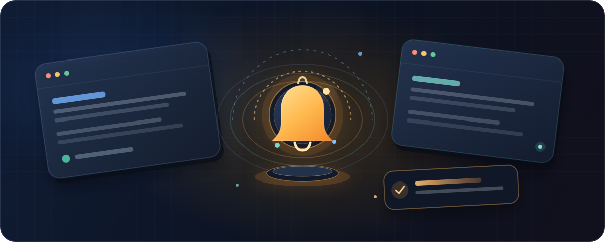

  

<h1 align="center">DoneDing</h1>

  <strong>Keep working. Hear the ding. Return when AI is ready.</strong> 
  A Chrome extension that monitors supported AI conversations across your open tabs and alerts you when a response finishes.

  
  
  
  

  <a href="#features">Features</a> ·
  <a href="#supported-ai-sites">Supported AI sites</a> ·
  <a href="#get-started">Get started</a> ·
  <a href="#privacy--permissions">Privacy &amp; permissions</a> ·
  <a href="#troubleshooting">Troubleshooting</a>

---

## The problem

You send a long prompt, switch tabs, then keep coming back to see if the AI has finished. DoneDing watches supported AI conversations in the background and lets you know when they are ready—so you can stay focused on what you were doing.

## Features

| Feature | What it does |
| --- | --- |
| **Multi-tab monitoring** | Tracks supported AI conversations across open Chrome tabs. |
| **Distinct sounds** | Choose from six chimes and assign sounds to a site or individual tab. |
| **Browser-wide banner** | See which AI finished while browsing another page, then jump back to its tab. |
| **Desktop alerts** | Get an optional Chrome/operating-system notification. |
| **Choose when to alert** | Enable or disable sounds, the banner, and desktop notifications independently. |
| **Background-tab mode** | Alert only when you are away from the AI tab or window. |
| **Recent completions** | See recent alerts and your completion count in the popup. |
| **No DoneDing login** | The current version does not require a DoneDing account. |

## Supported AI sites

DoneDing currently targets 27 AI services:

**ChatGPT · Claude · Google Gemini · Google AI Studio · NotebookLM · Notion AI · DeepSeek · Perplexity · Microsoft Copilot · Grok · Poe · Mistral Le Chat · Qwen Chat · Kimi · HuggingChat · Meta AI · Phind · You.com · Cohere Coral · Vercel v0 · Bolt.new · Lovable · Replit AI · Character.AI · Pi AI · Duck.ai · Blackbox AI**

AI services can change their websites without notice, which may temporarily affect completion detection. If a site stops working, please report it with the service name and a short description of the issue.

## Get started

### Chrome Web Store

**Listing:** Coming soon.

### Try it from source

1. Download or clone this repository.
2. Open `chrome://extensions` in Chrome.
3. Turn on **Developer mode**.
4. Select **Load unpacked** and choose the DoneDing project folder.
5. Open or refresh a supported AI site and start a conversation.
6. Open the DoneDing popup to review active sessions and adjust your alerts.

Keep the AI conversation tab open. When the response finishes, DoneDing will show the alerts you have enabled. Source-installed copies must be updated manually; Chrome Web Store installations receive published updates through Chrome.

## Privacy & permissions

DoneDing does not require a DoneDing account. Its page scripts monitor supported AI sites for response activity and send the site name, tab title, and completion status to the extension's background service worker so it can coordinate alerts.

Settings and recent-completion details are stored with Chrome's `storage.sync`. This can include the AI site, tab title, sound choice, and completion timing. Chrome may sync this information across your Chrome browsers if Chrome Sync is enabled. Recent completions can be cleared from the popup.

DoneDing requests the following permissions:

| Permission | Purpose |
| --- | --- |
| `storage` | Save settings and recent-completion details with Chrome. |
| `notifications` | Show optional desktop notifications. |
| `offscreen` | Play a sound when the AI tab is in the background. |
| `tabs` | Track supported AI tabs and return you to a completed conversation. |
| `scripting` | Refresh detection in supported tabs when needed. |
| `<all_urls>` host access | Show the browser-wide banner on the page you are currently viewing, even when it is not an AI site. |

The completion-detection scripts are configured for the supported AI sites listed above. The broad host permission is used for the cross-tab banner feature; review Chrome's permission prompt and install only if you are comfortable with that access.

## Troubleshooting

- **No alert?** Make sure DoneDing is enabled and the conversation appears under **Open Sessions**.
- **The AI tab was already open?** Refresh it after installing or updating DoneDing.
- **No desktop notification?** Check Chrome's notification permission and your operating system's notification settings.
- **A site stopped working?** The service may have changed its interface. [Open an issue](https://github.com/ibrahimadel000/DoneDing-Sound-Alert-for-ChatGPT-AI/issues) with the site name and what happened.

## Project details

- **Current manifest version:** `8.1.0`
- **Browser:** Google Chrome (Manifest V3)
- **Price:** Free for the current release
- **Chrome Web Store listing:** Coming soon

## Acknowledgements

- <b>Special thanks:</b> [Khalil AL-Rahman Moftah](https://github.com/moftahykh) (<code>@moftahykh</code>) for helping me with this project. ❤️

## License

This repository does not currently include a `LICENSE` file. Add a license before inviting others to reuse or redistribute the code.

---

DoneDing · Stay focused. Get notified. Get back to it.

